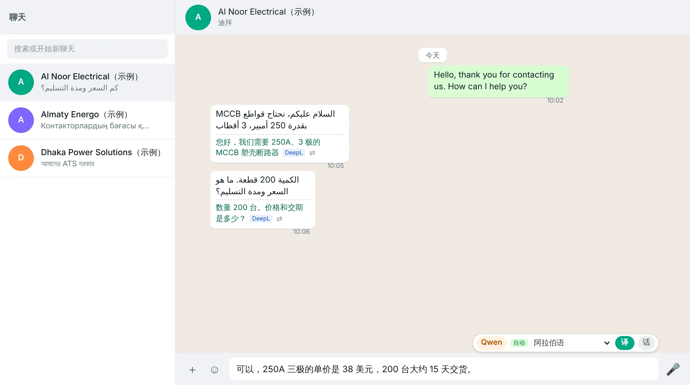
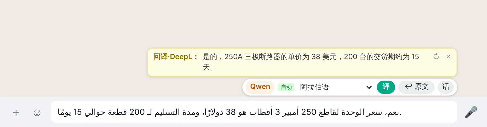
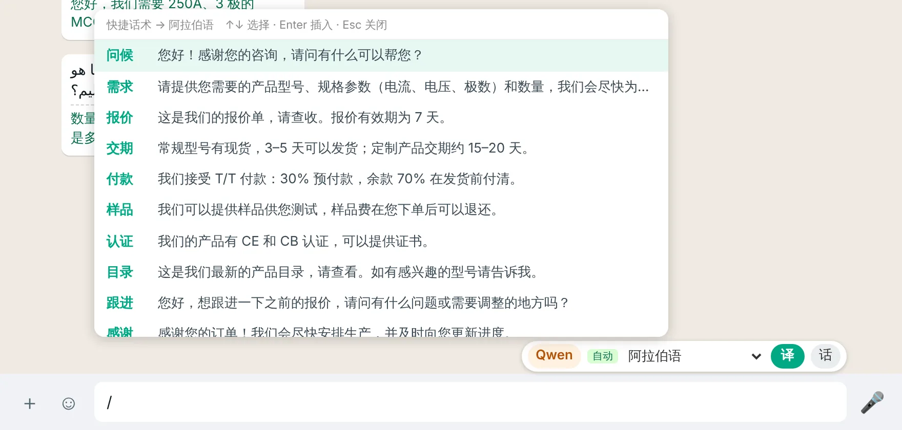
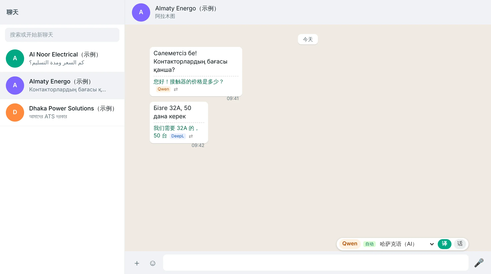
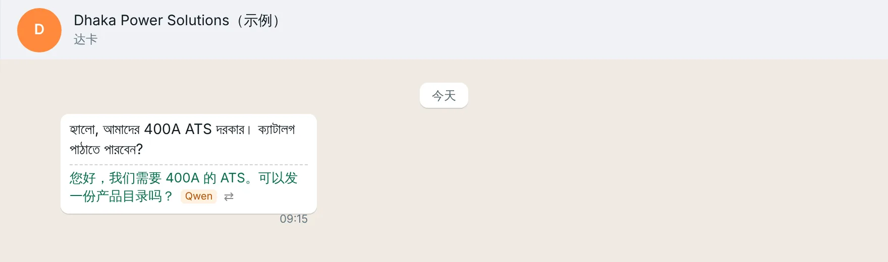

<p align="center"></p>

<h1 align="center">TradeLingo</h1>
<p align="center"><b>Translator for WhatsApp Web, built for foreign-trade sales.</b><br>
Read every customer message in your own language, write replies in your language, and send them in theirs.</p>

<p align="center">English · <a href="README.zh-CN.md">简体中文</a></p>

> **Disclaimer.** TradeLingo is an independent open-source project. It is **not affiliated with, endorsed by, or sponsored by WhatsApp or Meta**. "WhatsApp" is a trademark of its respective owner and is used here only to describe what the extension works with. TradeLingo is also unrelated to the Chrome Web Store extension "TradeLingo — Learn Construction Spanish While Browsing".


<sub>Sample screenshot. Customer names and messages are fictional.</sub>

## Features

- **Incoming messages are translated automatically**, shown under each bubble with a tag for the engine used. Click ⇄ to retranslate one message with another engine.
- **Write in your language, send in theirs.** Click **译** (Translate) or press <kbd>Alt</kbd>+<kbd>T</kbd> to replace your draft with the translation, then press Enter yourself. TradeLingo never sends messages for you.
- **Back-translation check.** After translating, a yellow box shows the translation translated back into your language, so you can confirm prices, quantities and lead times before sending.
- **Per-chat language memory.** Each chat's language is detected with Chrome's built-in language detector (no API quota used) and remembered. Customer messages count most; before a customer replies, your own earlier foreign-language messages are used. You can pin a language per chat.
- **Quick phrases.** Type <kbd>/</kbd> plus a keyword to insert a saved phrase, translated into the current customer's language. The sample phrases use Chinese keywords such as `/交期` (lead time); edit them in the settings page.
- **Glossary.** Force your own terminology (for example `MCCB = moulded case circuit breaker`) for the AI engines.
- **Three engines with automatic fallback.** DeepL, Qwen-MT (Alibaba Cloud Model Studio) and DeepSeek. If one fails (invalid key, quota, outage), TradeLingo switches to the next engine that has a key.
- **More than 30 target languages**, including Bengali, Kazakh, Uzbek, Hindi, Urdu, Persian, Vietnamese, Thai, Malay and Filipino through the AI engines.

The user interface is currently in **Simplified Chinese**. Contributions for other UI languages are welcome.

## Engines

| Engine | Default use | Strengths | Get a key |
|---|---|---|---|
| DeepL | Incoming messages | Fast and stable; free plan includes 500,000 characters per month | deepl.com → Account → API Keys |
| Qwen-MT | Outgoing replies | Dedicated translation model, 92 languages, glossary (term intervention), very low cost | Alibaba Cloud Model Studio (Bailian) → API Key |
| DeepSeek | Fallback | Uses recent chat context, adjustable tone | platform.deepseek.com → API Keys |

At least one key is required. Keys are stored only in your browser (`chrome.storage.local`).

## Install

TradeLingo is not on the Chrome Web Store yet. Load it as an unpacked extension:

1. Download this repository (Code → Download ZIP) and unzip it.
2. Open `chrome://extensions` and turn on **Developer mode**.
3. Click **Load unpacked** and select the **`extension`** folder.
4. Click the TradeLingo icon in the toolbar, paste your API key(s) and click **保存并测试** (Save & test).
5. Reload WhatsApp Web.

To update, replace the files in the same folder, click ⟳ on the extension card, and reload WhatsApp Web. Keep loading from the same folder: Chrome ties saved settings to the folder you loaded, so loading from a new folder starts with empty settings.

## Screenshots

| Back-translation check | Quick phrases |
|---|---|
|  |  |

| Per-chat language memory | AI engines for languages DeepL does not support |
|---|---|
|  |  |

A full illustrated manual (Simplified Chinese) is in [`docs/manual.zh-CN.html`](docs/manual.zh-CN.html). Download and open it in a browser.

## Keyboard shortcuts

| Keys | Action |
|---|---|
| <kbd>Alt</kbd>+<kbd>T</kbd> | Translate the message box |
| <kbd>Alt</kbd>+<kbd>B</kbd> | Back-translate the message box |
| <kbd>/</kbd> + keyword | Open quick phrases |
| <kbd>Alt</kbd>+<kbd>Shift</kbd>+<kbd>D</kbd> | Copy diagnostic info (contains no message text or phone numbers) |

## Privacy

- Message text is sent only to the translation provider you choose (DeepL, Alibaba Cloud or DeepSeek), directly from your browser. There is no TradeLingo server.
- API keys, glossary, phrases and per-chat languages are stored locally in your browser.
- Per-chat language records store only a hash of the chat ID, never phone numbers.

See [PRIVACY.md](PRIVACY.md) for details.

## Risks and limitations

- TradeLingo modifies the WhatsApp Web page in your browser. This may not be permitted by WhatsApp's Terms of Service. It only reads and translates text and never sends messages automatically, but **use it at your own risk**.
- WhatsApp Web changes its page structure from time to time. If translations stop appearing, open a chat, press <kbd>Alt</kbd>+<kbd>Shift</kbd>+<kbd>D</kbd> and include the copied diagnostic info in an issue.
- Machine translation can be wrong. Always check important terms before sending.

## Project structure

```
extension/        Chrome extension (Manifest V3) — load this folder
  manifest.json
  background.js   Calls DeepL / Qwen-MT / DeepSeek, cache, fallback
  content.js      Runs on WhatsApp Web: translations, toolbar, back-translation, phrases, per-chat language
  content.css
  options.html/js Settings page
  common.js       Shared defaults and language list
  icons/
docs/             Screenshots, logo, illustrated manual
```

No build step and no dependencies.

## Contributing

Issues and pull requests are welcome, especially:

- English and other UI translations
- Selector fixes when WhatsApp Web changes
- More translation engines

## License

[MIT](LICENSE)
