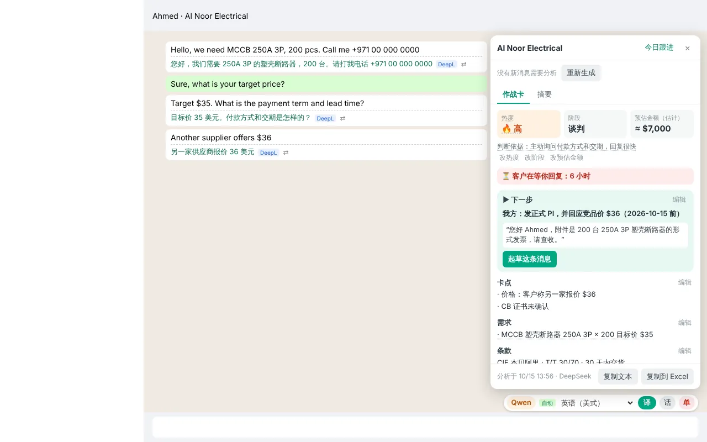
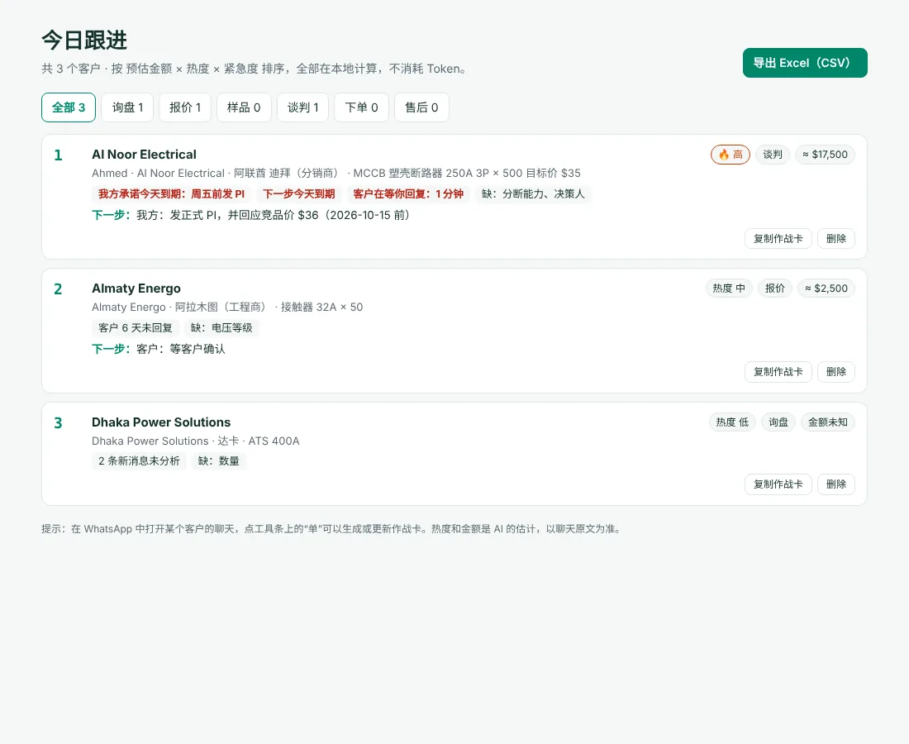

<p align="center"></p>

<h1 align="center">TradeLingo</h1>
<p align="center"><b>为外贸销售打造的 WhatsApp 网页版翻译插件</b><br>
看懂每一条客户消息，用中文写回复，一键发出客户的语言。</p>

<p align="center"><a href="README.md">English</a> · 简体中文</p>

> **免责声明**：TradeLingo 是独立的开源项目，**与 WhatsApp、Meta 没有任何关联，也未获得其认可或赞助**。“WhatsApp”是其所有者的商标，本项目只用它来说明插件适用的网站。本项目也与 Chrome 应用店中的插件“TradeLingo — Learn Construction Spanish While Browsing”无关。


<sub>示意截图，客户名称和对话内容均为示例。</sub>

## 功能

- **收到的消息自动翻译**：译文显示在消息气泡下方，并带有所用引擎的标签。点 ⇄ 可以换一个引擎重新翻译这一条。
- **用中文写，发外语**：点“译”或按 <kbd>Alt</kbd>+<kbd>T</kbd>，输入框里的中文会被替换成译文，确认后自己按回车发送。插件不会替你发送任何消息。
- **回译校对**：翻译后，黄色框会把译文翻回中文，方便你在发送前核对价格、数量、交期。
- **每个客户单独记住语言**：使用 Chrome 自带的语言识别（不消耗翻译额度）判断每个聊天的语言并记住。客户的消息权重最高；客户还没回复时，按你之前发出的外语消息判断。也可以为某个客户手动固定语言。
- **快捷话术**：输入 <kbd>/</kbd> 加关键词（如 `/报价`、`/交期`），插入预先保存的中文话术，并自动翻译成当前客户的语言。
- **术语表**：让 AI 引擎固定使用你指定的译法，例如 `塑壳断路器 = MCCB`。
- **三个引擎，出错时自动备用**：支持 DeepL、Qwen-MT（阿里云百炼）、DeepSeek。某个引擎出错（Key 无效、额度用完、服务故障）时，自动改用下一个已填写 Key 的引擎。
- **商机作战卡（DeepSeek）**：点工具条上的“单”，把当前聊天整理成一屏作战卡：热度及判断依据、阶段、预估金额、卡点、下一步（一键起草消息）、双方承诺、报价记录、缺失信息（一键生成追问）。每一项都能查看出自哪条消息，没有依据的写“未知”。之后更新时只发送新消息，AI 的改动以建议形式出现，由你逐条采纳或忽略；你手动改过的字段会被锁定。
- **今日跟进**：所有客户的作战卡按“预估金额 × 热度 × 紧急度”排序。紧急度包括承诺到期、客户在等你回复、客户沉默等，全部在本地计算，不消耗 Token；支持导出 Excel（CSV）。
- **跟进提醒**：我方承诺或下一步到期、客户等你回复太久时弹出桌面通知；每天早上推送一条“今日跟进”早报。浏览器后台每 15 分钟检查一次，不打开 WhatsApp 也能提醒；还会读取左侧聊天列表的未读数，没点开的聊天也不会漏。不消耗 Token。
- **备份与恢复**：把作战卡、话术、术语表、客户语言和设置导出为一个 JSON 文件（可选是否包含 API Key），在另一台电脑或浏览器中导入，导入时与现有数据合并。
- **Notion 同步**：作战卡可以自动写入你的 Notion 数据库（单向），手机上也能看跟进，方便给团队共享。只发送作战卡字段，不发送聊天原文和电话号码。
- **WhatsApp 改版预警**：WhatsApp 网页改版、插件认不出消息或输入框时，会明确提示，而不是悄悄失效；同时自动检查新版本，并可一键复制诊断信息反馈。
- **中英文界面**：设置里可以切换界面语言（自动 / 中文 / English）。
- **使用向导与新版本提醒**：安装后自动打开向导，手把手申请并测试 API Key；每天检查一次 GitHub 上有没有新版本，有的话图标上显示红色“新”，设置页顶部给出更新内容和下载链接。设置页还会显示各引擎本月用了多少字符。
- **30 多种目标语言**：其中孟加拉语、哈萨克语、乌兹别克语、印地语、乌尔都语、波斯语、越南语、泰语、马来语、菲律宾语通过 AI 引擎翻译。

## 引擎

| 引擎 | 默认用途 | 特点 | 获取 Key |
|---|---|---|---|
| DeepL | 收到的消息 | 快、稳定；免费版每月 50 万字符 | deepl.com → 账户 → API Keys |
| Qwen-MT | 发送的回复 | 专用翻译模型，92 种语言，支持术语干预，费用很低 | 阿里云百炼 → API Key（地域推荐华北2（北京）） |
| DeepSeek | 翻译备用；**商机作战卡只用它** | 能参考聊天上下文，可以调整语气 | platform.deepseek.com → API Keys |

至少需要填写一个 Key。所有 Key 只保存在你自己的浏览器里（`chrome.storage.local`）。

## 安装

目前还没有上架 Chrome 应用店，请以“已解压的扩展程序”方式加载：

1. 下载本仓库（Code → Download ZIP）并解压。
2. 打开 `chrome://extensions`，打开右上角的“开发者模式”。
3. 点“加载已解压的扩展程序”，选择仓库中的 **`extension`** 文件夹。
4. 安装后会自动打开使用向导：选一个翻译引擎，照着步骤申请 Key，点“保存并测试”。之后也可以点工具栏上的 TradeLingo 图标修改 Key。
5. 刷新 WhatsApp 网页版。

**Edge 浏览器**同样可以使用：打开 `edge://extensions`，打开左侧的“开发人员模式”，点“加载解压缩的扩展”。两个浏览器的设置互不共享，可以用“备份与恢复”迁移。

**升级方法**：有新版本时，插件图标上会出现红色“新”，设置页顶部有下载链接和步骤。用新文件覆盖同一个文件夹里的旧文件，在扩展程序页面点插件卡片上的 ⟳，再刷新 WhatsApp 网页。请始终从同一个文件夹加载插件：Chrome 按加载的文件夹保存插件设置，换一个文件夹加载，之前填写的 Key 和设置都不会带过去。

## 截图

| 回译校对 | 快捷话术 |
|---|---|
|  |  |

| 商机作战卡 | 今日跟进 |
|---|---|
|  |  |

| 每个客户单独记住语言 | DeepL 不支持的语言由 AI 引擎翻译 |
|---|---|
|  |  |

完整的图文使用手册见 [`docs/manual.zh-CN.html`](docs/manual.zh-CN.html)，下载后用浏览器打开即可。

## 快捷键

| 按键 | 作用 |
|---|---|
| <kbd>Alt</kbd>+<kbd>T</kbd> | 翻译输入框内容 |
| <kbd>Alt</kbd>+<kbd>B</kbd> | 把输入框内容回译成中文 |
| <kbd>/</kbd> + 关键词 | 调出快捷话术 |
| <kbd>Alt</kbd>+<kbd>Shift</kbd>+<kbd>D</kbd> | 复制诊断信息（不含消息内容和电话号码） |

## 隐私

- 消息内容只会从你的浏览器直接发送给你选择的翻译服务商（DeepL、阿里云或 DeepSeek）。TradeLingo 没有自己的服务器。
- API Key、术语表、话术和客户语言记录都只保存在你的浏览器里。
- 客户语言记录只保存聊天编号的哈希值，不保存电话号码。
- 商机作战卡只在你点击时，把当前聊天最近最多 80 条可见消息发给 DeepSeek，电话号码会先打码；作战卡保存在本地。

详见 [PRIVACY.md](PRIVACY.md)。

## 风险与局限

- 插件会修改你浏览器中的 WhatsApp 网页界面，这可能不符合 WhatsApp 的服务条款。插件只读取和翻译文字，不会自动发送消息，但**请自行承担使用风险**。
- WhatsApp 网页版会不定期改版。如果译文不再出现，请打开一个聊天，按 <kbd>Alt</kbd>+<kbd>Shift</kbd>+<kbd>D</kbd>，把复制出来的诊断信息附在 Issue 里。
- 机器翻译可能出错，重要内容请在发送前核对。

## 目录结构

```
extension/        Chrome 插件（Manifest V3），加载这个文件夹
  manifest.json
  background.js   调用 DeepL / Qwen-MT / DeepSeek，缓存与自动备用
  content.js      运行在 WhatsApp 网页版：译文、工具条、回译、话术、按客户记住语言
  deal.js         商机作战卡面板（DeepSeek）
  dealcore.js     商机共用逻辑：排序、文字与 CSV 导出
  deals.html/js   今日跟进页
  content.css
  options.html/js 设置页
  welcome.html/js 首次使用向导
  common.js       共享默认设置和语言列表
  notion.js       Notion 同步（作战卡 → Notion 数据库）
  i18n.js         界面语言（中文 / English）与英文词典
  icons/
docs/             截图、图标、图文手册
```

无需构建，没有第三方依赖。

## 参与贡献

欢迎提交 Issue 和 Pull Request，特别是以下几类：

- 英文及其他语言的界面翻译
- WhatsApp 网页改版后的页面适配
- 接入更多翻译引擎

## 许可证

插件以 [MIT 许可证](LICENSE) 开源。`docs/` 中的网站、标志、截图和图文手册不适用 MIT 许可证，保留所有权利，详见 [docs/LICENSE-website.md](docs/LICENSE-website.md)。
